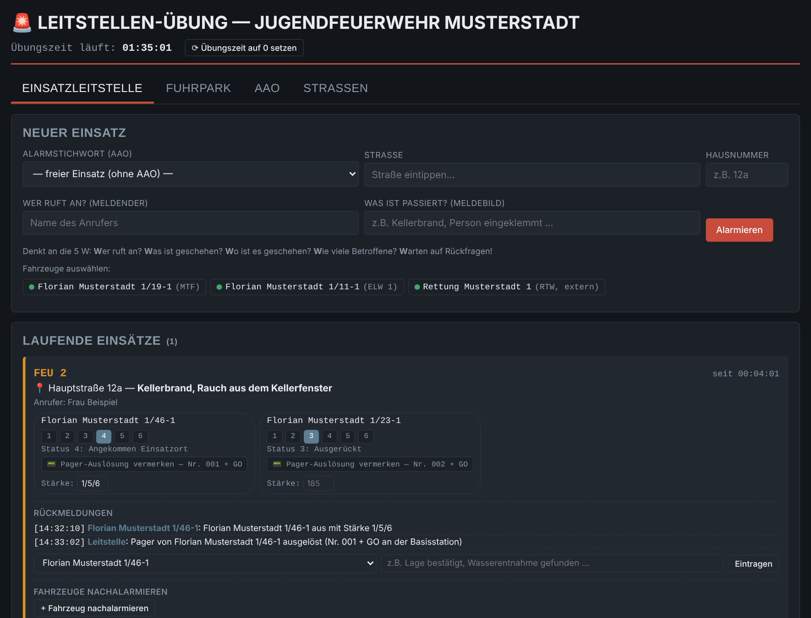
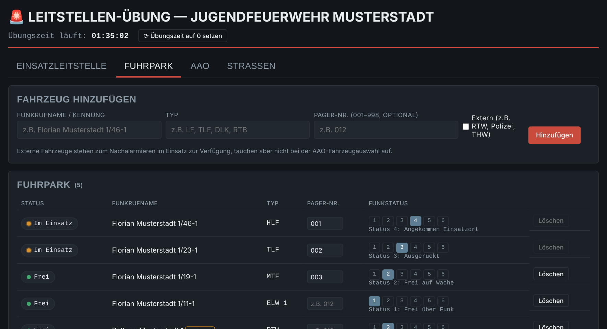
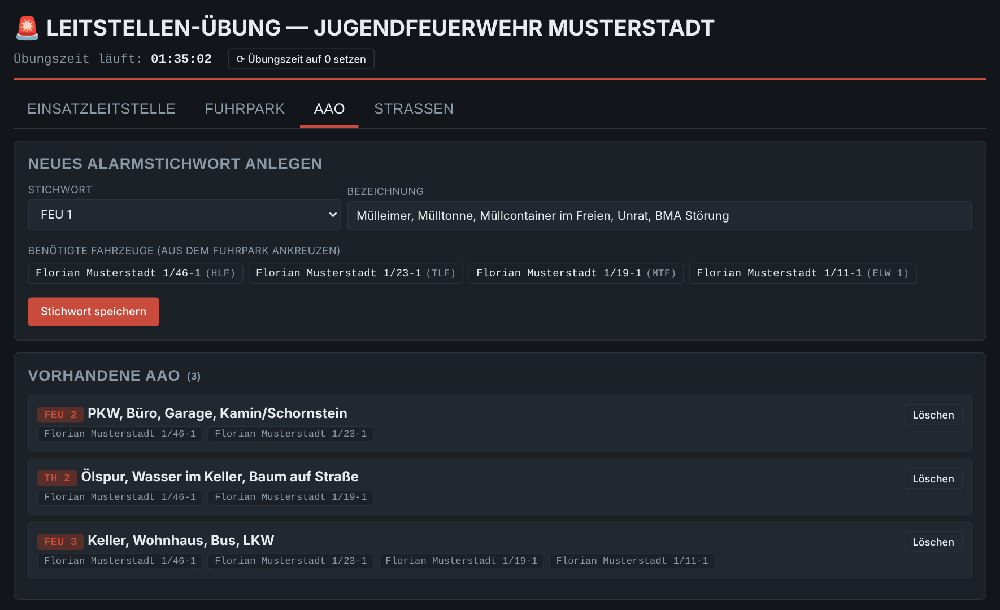
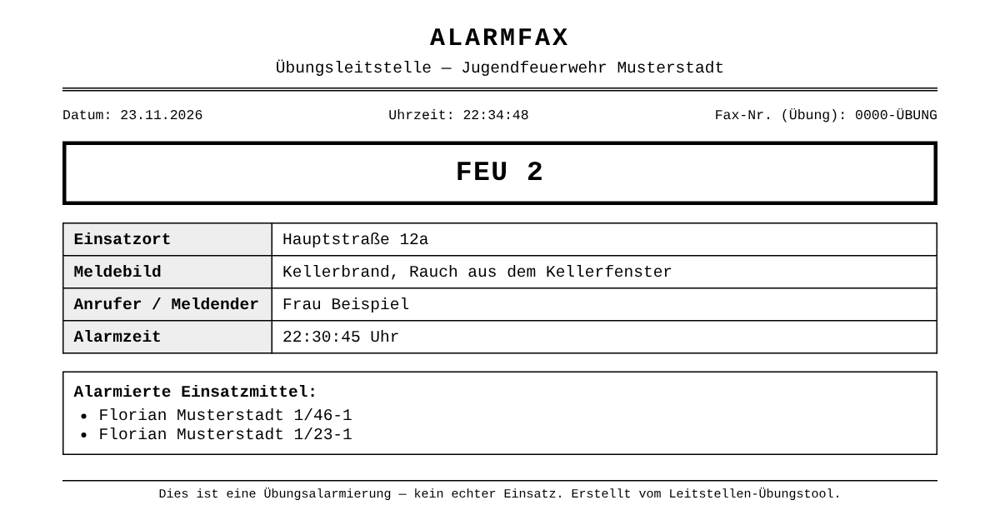

# Leitstellen-Übungstool

Ein einfaches, browserbasiertes Übungstool für die Jugendfeuerwehr, mit dem sich eine
24-Stunden-Übung (oder jede andere Übung) realistisch als „Einsatzleitstelle“ simulieren
lässt: Alarmierung nach AAO, Fuhrpark mit Funkstatus, Rückmeldungen, Nachalarmierung,
Alarmfax-Druck und ein druckbarer Einsatzbericht am Ende.

Entwickelt und erfolgreich eingesetzt bei der 24h-Übung der Jugendfeuerwehr Eisern
(September 2026). Frei nutzbar für andere Jugendfeuerwehren — siehe [LICENSE](LICENSE).

**Direkt ausprobieren:** <https://frankkreutz-lab.github.io/leitstellen-uebungstool/>
(läuft komplett in deinem Browser, es werden keine Daten übertragen)

## Funktionen

- **Einsatzleitstelle**: Alarme mit AAO-Stichwort, Straße, Meldebild und Anrufer
  aufnehmen, passende Fahrzeuge werden anhand der hinterlegten AAO vorgeschlagen
- **Fuhrpark**: Fahrzeuge mit Funkstatus 1–6 verwalten (inkl. externer Kräfte wie
  RTW/Polizei/THW, die nicht in der AAO-Vorschlagsliste auftauchen)
- **Statusregel**: Von Status 3 oder 4 (unterwegs/an der Einsatzstelle) geht es nicht
  direkt auf Status 2 (Wache), sondern nur über Status 1. Status 6 ist jederzeit möglich.
  Die Regel lässt sich in der Datei anpassen (`NO_DIRECT_STATUS2_FROM`).
- **AAO**: eigene Alarmstichworte mit Fahrzeugbedarf anlegen (ein Satz gängiger
  Feuerwehr-Stichworte ist als Vorlage vorausgefüllt, aber frei anpassbar)
- **Straßenverzeichnis**: Straßen für Autovervollständigung bei der Alarmierung
- Rückmeldungen, Stärke-Meldungen und Nachalarmierung pro laufendem Einsatz
- Alarmfax und Einsatzbericht als Druck-/PDF-Ansicht
- Pager-Nummern pro Fahrzeug hinterlegbar (für Funkmeldeempfänger wie FirePager,
  rein informativ — es gibt keine automatische Schnittstelle zur Basisstation)
- Backup als JSON-Datei herunterladen/einspielen, damit Fuhrpark/AAO/Straßen nicht
  bei jeder Übung neu eingetragen werden müssen

| Fuhrpark mit Funkstatus | AAO mit Fahrzeugbedarf |
|---|---|
|  |  |

*Alle Screenshots zeigen erfundene Beispieldaten.*

## Einrichtung für eure Wehr

1. Entweder die [Release-Datei](../../releases/latest) `leitstellen-uebung.html` herunterladen
   und auf dem Übungs-Laptop im Browser öffnen (funktioniert offline, keine Installation),
   oder die Seite oben direkt im Browser aufrufen.
2. Im Bereich **„Einrichtung“** ganz unten euren Wehrnamen eintragen und speichern
   — er erscheint dann im Titel sowie auf Alarmfax und Einsatzbericht
3. Falls ihr eine Kopie mit Testdaten einer anderen Wehr erhalten habt: unter
   **Datensicherung → „🆕 Neue Wehr einrichten“** einmal alles außer dem Namen
   löschen, damit ihr bei null anfangt
4. Unter dem Reiter **Fuhrpark** eure Fahrzeuge anlegen
5. Unter **AAO** eure Alarmstichworte mit Fahrzeugbedarf anlegen
6. Unter **Straßen** euer Straßenverzeichnis anlegen (oder einfach während der
   Übung „on the fly“ neue Straßen bestätigen)
7. Vor der eigentlichen Übung: **Datensicherung → Backup herunterladen**, damit
   ihr die Einrichtung nicht verliert, falls der Browser-Speicher mal leer sein
   sollte

## Datenspeicherung und Datenschutz

Alle Daten (Fuhrpark, AAO, Straßen, Einsätze, Log) werden **lokal im Browser**
gespeichert (`localStorage`), es läuft kein Server und es werden keine Daten irgendwo
hochgeladen. Das Tool lädt auch keine Schriften oder Skripte von fremden Servern nach.
Wechselt ihr den Browser oder den Rechner oder löscht den Browser-Speicher, sind die
Daten weg — deshalb regelmäßig ein Backup (JSON-Datei) herunterladen, vor allem kurz
vor der Übung.

Backup-Dateien werden beim Einspielen geprüft und bereinigt. Trotzdem gilt: Spielt nur
Backups aus Quellen ein, denen ihr vertraut.

## Einschränkungen

- Reine Übungssoftware — für echte Einsätze/Alarmierung nicht geeignet
- Keine Mehrbenutzer-Synchronisation: läuft nur lokal auf einem Gerät/Browser
- Kein automatisches Auslösen von Funkmeldeempfängern (Pager) — die Pager-Nummer
  wird nur angezeigt, ausgelöst wird weiterhin manuell an der Basisstation
- Die vorausgefüllte AAO ist eine Vorlage und muss an eure Wehr angepasst werden

## Anpassungen & Mitmachen

Wünsche, Fehler oder Verbesserungen? Gerne als Issue oder Pull Request hier im
Repository. Wenn ihr größere Änderungen für eure Wehr macht, freuen wir uns über
Rückmeldung — vielleicht profitieren auch andere Jugendfeuerwehren davon.

## Credit & Lizenz

Ursprünglich entwickelt von **Frank Kreutz** für die Jugendfeuerwehr Eisern.
Veröffentlicht unter der MIT-Lizenz (siehe [LICENSE](LICENSE)) — ihr dürft das Tool
frei nutzen, anpassen und weitergeben, solange der Copyright-Hinweis erhalten bleibt.
